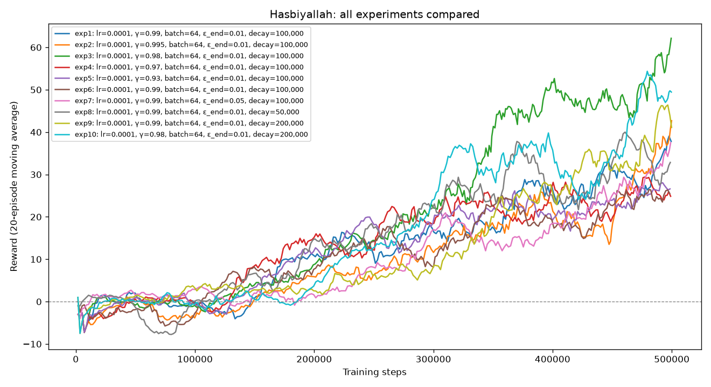

# Hyperparameter Experiments – Hasbiyallah Umutoniwabo

Environment: `ALE/Boxing-v5` · Steps per experiment: 500,000 · Seed: 2 for all runs · Fixed settings: buffer 50,000, target update every 1,000 steps, train every 4 steps, 10,000 warm-up steps, learning rate 1e-4, batch size 64.

My area is **gamma and exploration (epsilon)**. Experiment 1 is Teddy's best setup run with my seed. Experiments 2–5 change only gamma. Experiments 6–9 change only one epsilon setting. Experiment 10 combines the best gamma and the best epsilon setting I found.

Score = my agent's punches − the opponent's punches (−100 to +100, 0 = even fight). A round lasts about 1,780 steps unless a boxer wins by knock-out (100 punches), so **a shorter average round in a good run means the agent is winning by knock-out**.

| Exp | Learning rate | Gamma | Batch size | Epsilon start | Epsilon end | Epsilon decay (steps) | Mean game score (last 20 ep.) | Observed behaviour |
|---|---|---|---|---|---|---|---|---|
| 1 | 1e-4 | 0.99 | 64 | 1.0 | 0.01 | 100,000 | 37.8 | Baseline (Teddy's best setup, my seed). Scored 37.8, well below Teddy's +60.3 with the same settings, so the seed alone changes the result a lot. Average round 1,362 steps, so some knock-outs. |
| 2 | 1e-4 | 0.995 | 64 | 1.0 | 0.01 | 100,000 | 42.7 | Slightly better than the baseline. A far-sighted agent still learned well, but the gap is small, so it could be chance. |
| 3 | 1e-4 | 0.98 | 64 | 1.0 | 0.01 | 100,000 | 62.15 | **Best.** Highest score, best single round 93, and the shortest rounds (average 1,006 steps), so it won many rounds by knock-out. |
| 4 | 1e-4 | 0.97 | 64 | 1.0 | 0.01 | 100,000 | 24.85 | **Worst.** Clearly below the baseline. Rounds were almost full length (1,503 steps), so it rarely won by knock-out. |
| 5 | 1e-4 | 0.93 | 64 | 1.0 | 0.01 | 100,000 | 26.6 | Similar to exp 4. A short-sighted agent (low gamma) did clearly worse than the baseline here. Still above 0, so it was winning on points. |
| 6 | 1e-4 | 0.99 | 64 | 0.5 | 0.01 | 100,000 | 25.5 | Much worse than the baseline. Starting at 50% random moves means less exploration early on, which probably left the replay buffer with a narrower set of experiences. I didn't measure this, so it is my best explanation. |
| 7 | 1e-4 | 0.99 | 64 | 1.0 | 0.05 | 100,000 | 37.5 | Almost the same as the baseline (37.8). Keeping 5% random moves at the end made no visible difference. |
| 8 | 1e-4 | 0.99 | 64 | 1.0 | 0.01 | 50,000 | 32.85 | Slightly below the baseline. Exploring for only 50,000 steps was a bit short, but the gap is small and could be chance. |
| 9 | 1e-4 | 0.99 | 64 | 1.0 | 0.01 | 200,000 | 41.1 | Slightly above the baseline, with a best round of 86. Exploring longer helped a little, but the gap is small. |
| 10 | 1e-4 | 0.98 | 64 | 1.0 | 0.01 | 200,000 | 49.45 | Combination of the best gamma (0.98, exp 3) and the best epsilon decay (200,000, exp 9). Better than the baseline but **worse than exp 3 (62.15)**: the best values did not add up. |



## Commands

```bash
uv run train.py --member Hasbiyallah --exp 1  --seed 2 --lr 1e-4 --gamma 0.99  --batch_size 64 --eps_start 1.0 --eps_end 0.01 --eps_decay 100000 --total_steps 500000
uv run train.py --member Hasbiyallah --exp 2  --seed 2 --lr 1e-4 --gamma 0.995 --batch_size 64 --eps_start 1.0 --eps_end 0.01 --eps_decay 100000 --total_steps 500000
uv run train.py --member Hasbiyallah --exp 3  --seed 2 --lr 1e-4 --gamma 0.98  --batch_size 64 --eps_start 1.0 --eps_end 0.01 --eps_decay 100000 --total_steps 500000
uv run train.py --member Hasbiyallah --exp 4  --seed 2 --lr 1e-4 --gamma 0.97  --batch_size 64 --eps_start 1.0 --eps_end 0.01 --eps_decay 100000 --total_steps 500000
uv run train.py --member Hasbiyallah --exp 5  --seed 2 --lr 1e-4 --gamma 0.93  --batch_size 64 --eps_start 1.0 --eps_end 0.01 --eps_decay 100000 --total_steps 500000
uv run train.py --member Hasbiyallah --exp 6  --seed 2 --lr 1e-4 --gamma 0.99  --batch_size 64 --eps_start 0.5 --eps_end 0.01 --eps_decay 100000 --total_steps 500000
uv run train.py --member Hasbiyallah --exp 7  --seed 2 --lr 1e-4 --gamma 0.99  --batch_size 64 --eps_start 1.0 --eps_end 0.05 --eps_decay 100000 --total_steps 500000
uv run train.py --member Hasbiyallah --exp 8  --seed 2 --lr 1e-4 --gamma 0.99  --batch_size 64 --eps_start 1.0 --eps_end 0.01 --eps_decay 50000  --total_steps 500000
uv run train.py --member Hasbiyallah --exp 9  --seed 2 --lr 1e-4 --gamma 0.99  --batch_size 64 --eps_start 1.0 --eps_end 0.01 --eps_decay 200000 --total_steps 500000
uv run train.py --member Hasbiyallah --exp 10 --seed 2 --lr 1e-4 --gamma 0.98  --batch_size 64 --eps_start 1.0 --eps_end 0.01 --eps_decay 200000 --total_steps 500000
```

I trained these on Kaggle's GPU (T4). Comparison chart: `uv run compare_experiments.py --member Hasbiyallah`

## Best and worst configurations

- **Best:** exp 3 (gamma 0.98), 62.15. It had the highest score and the shortest rounds (about 1,006 steps on average), which means the agent was often winning by knock-out.
- **Worst:** exp 4 (gamma 0.97), 24.85. Exp 6 (25.5) and exp 5 (26.6) were almost as low. All three had rounds close to full length (about 1,500 steps), so they rarely won by knock-out.

## What helped and what hurt

- **Gamma:** gamma controls how much the agent cares about future rewards compared with rewards right now. Gamma 0.98 helped the most (62.15). Going lower (0.97 and 0.93) hurt, and going higher (0.995) gave a small gain over 0.99. The pattern is not a clean line (0.99 gave 37.8, 0.98 gave 62.15, 0.97 gave 24.85), which tells me noise is part of this result and I should not claim that "0.98 is exactly the right value".
- **Epsilon start:** starting at 0.5 instead of 1.0 hurt a lot (25.5 vs 37.8). With fewer random moves at the start, the agent probably collected less varied experience to learn from. I didn't measure this, so it is my best explanation, not a proven cause.
- **Epsilon end:** 0.05 instead of 0.01 made no real difference (37.5 vs 37.8).
- **Epsilon decay:** a faster decay (50,000) was slightly worse (32.85) and a slower decay (200,000) was slightly better (41.1). Both differences are small, so I treat them as a weak trend, not a proven effect.
- **Shape of the curves:** in the comparison chart, the low-gamma runs (exps 4 and 5) climbed fastest at the start and reached about +20 by 250,000 steps. After that they flattened out around 25, while exp 3 kept going and pulled ahead after about 300,000 steps. Teddy saw the same thing in his gamma runs: an agent that only looks a few moves ahead learns quickly at first but stops improving earlier. Also, almost every line was still going up at 500,000 steps and the lines jump up and down a lot, so my final "last 20 episodes" score depends partly on where each run happened to be on its last swing. That is another reason I don't trust small gaps.

**Limitation:** each configuration was run once. DQN results vary from run to run, and I saw this myself. My first attempt at exps 1–3 was interrupted when Kaggle reset my session, so I ran them again with the same settings and the same seed. The scores were different (exp 1: 39.25 then 37.8, exp 2: 29.1 then 42.7, exp 3: 23.2 then 62.15). Exp 3 in particular went from 23.2 to 62.15 with identical settings, so even a gap of 20–40 points can come from chance. I only trust big, repeated patterns. The most reliable one in my results is that low gamma values (0.97 and 0.93) and a low epsilon start (0.5) all finished around 25, well below the baseline.

## Final configuration and justification

**Chosen: experiment 3:** learning rate 1e-4, gamma 0.98, batch size 64, epsilon 1.0 → 0.01 over 100,000 steps.

- It had the highest training score of my 10 runs (62.15) and the shortest rounds, so it was winning many rounds by knock-out.
- Experiment 10 (the "best values combined") scored lower (49.45). This shows that hyperparameters interact and that the best values do not simply add up. The only difference between exp 3 and exp 10 is the epsilon decay (100,000 vs 200,000), so the longer exploration did not help when combined with gamma 0.98, or the difference is just run-to-run noise.
- Because of the noise I saw in my reruns, this choice is my best guess from one run per setting, not a proven result.
