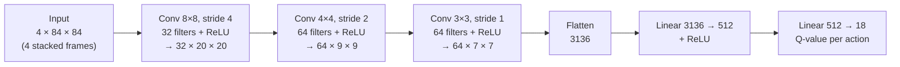
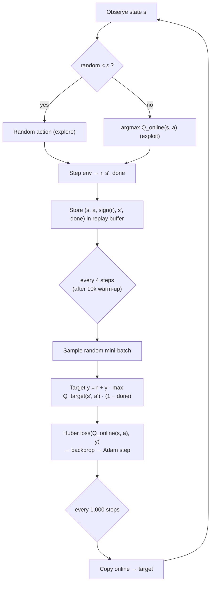
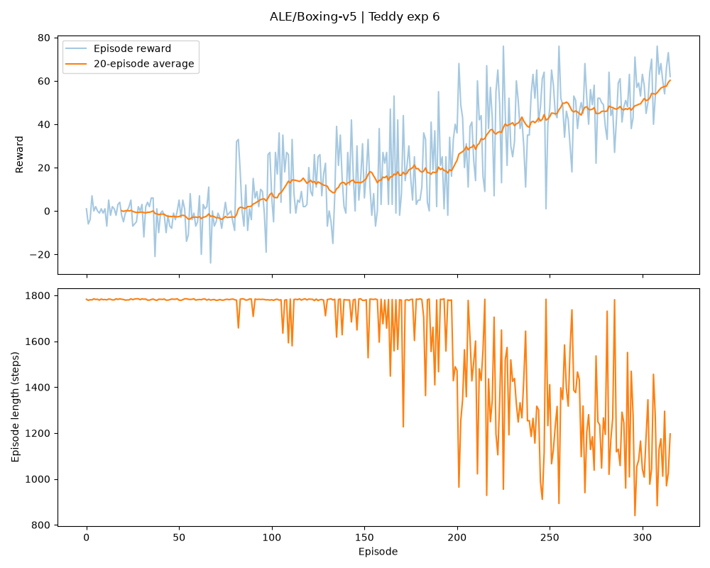

# Deep Q-Network (DQN) on Atari Boxing

A DQN agent built from scratch with **PyTorch** and **Gymnasium** that learns to play Atari Boxing from raw pixels. No ready-made DQN libraries were used (no Stable-Baselines3, RLlib, CleanRL or TorchRL): the network, replay buffer, ε-greedy policy, Bellman update and training loop are all our own code.

## 1. Project introduction

### Group members

| Member | Main contribution |
| --- | --- |
| Tedla Tesfaye Godebo | DQN implementation (`train.py`, `play.py`, `common.py`, `compare_experiments.py`), 10 experiments (baseline sweep), live demo |
| Parfait Uhiriwe | 10 experiments (learning rate and batch size), README, gameplay video |
| Hasbiyallah Umutoniwabo | 10 experiments (gamma and exploration), slides, presentation booking, task allocation sheet |

The full task breakdown is in `Task allocation sheet.pdf`.

### Environment: `ALE/Boxing-v5`

A top-down view of a boxing ring. Our agent controls the **white** boxer and fights the built-in computer opponent (**black**). The goal is to land more punches than the opponent.

- **+1** each time our agent lands a punch, **−1** each time it gets punched.
- A round lasts 2 minutes of game time (about 1,780 agent steps), or ends early by **knock-out** when one boxer lands 100 punches.
- The episode score is our punches minus the opponent's punches, so it ranges from **−100 to +100**. A random agent scores about 0; a positive score means our agent is winning.
- **Action space:** 18 discrete actions (NOOP, FIRE = punch, 8 movement directions, and each direction combined with a punch).

## 2. DQN architecture

Each observation is a stack of the **last 4 frames**, converted to grayscale and resized to 84×84. A single frame can't show which way the boxers are moving; four frames together show motion.



Two copies of this network are used:

- **Online network:** chooses actions and is updated by gradient descent.
- **Target network:** a frozen copy used to compute the learning targets. It is overwritten with the online weights every 1,000 steps, which stops the targets from shifting at every update and keeps learning stable.

### Training process



1. **Warm-up:** the first 10,000 steps fill the replay buffer before any learning happens.
2. **ε-greedy exploration:** ε decays linearly from `eps_start` to `eps_end` over `eps_decay` steps, then stays constant. Early on the agent mostly explores; later it mostly uses what it has learned.
3. **Reward clipping:** only the sign of the reward (+1 / 0 / −1) is stored for learning, as in the original DQN paper. In Boxing every reward is already ±1, so this has no effect here, but it keeps the code correct for other Atari games.
4. **Experience replay:** transitions are stored in a circular buffer (50,000 by default). Training on random mini-batches breaks the correlation between consecutive frames and reuses each experience many times.
5. **Bellman update:** the online network predicts Q(s, a); the target is `r + γ · max_a' Q_target(s', a')`, with the future term dropped when the round has truly ended (`terminated`, not a time-limit `truncated`). The Huber (smooth L1) loss between them is backpropagated, and Adam updates the online network.
6. **Target sync:** every 1,000 steps the target network copies the online weights.
7. **Logging:** each episode's length, total step count, reward and ε are written to `training_log.csv`, and a reward/length plot is saved at the end.

## Project structure

```
common.py                  environment setup + Q-network (shared by train.py and play.py)
train.py                   training loop: replay buffer, ε-greedy, Bellman update, target network
play.py                    loads dqn_model.pth and plays greedily in a game window
compare_experiments.py     draws all of one member's experiments on a single chart
dqn_model.pth              best trained model (copy of models/Teddy/exp6/dqn_model.pth)
models/<member>/exp<N>/    one folder per experiment: dqn_model.pth, training_log.csv,
                           training_plot.png, summary.json
<Member>_Hyperparameter_experiment_results.md   each member's experiment table
Task allocation sheet.pdf  who did what
```

## Setup and usage (uv)

This project uses **uv** as its only package and environment manager.

```bash
uv sync    # create the environment and install all dependencies

# Train one experiment (this is the best configuration)
uv run train.py --member Teddy --exp 6 --lr 1e-4 --gamma 0.99 --batch_size 64 \
    --eps_start 1.0 --eps_end 0.01 --eps_decay 100000 --total_steps 500000

# Watch the best model play (press Q to close the window)
uv run play.py --model dqn_model.pth --episodes 3

# Compare all of one member's experiments on one chart
uv run compare_experiments.py --member Teddy
```

## Results

### Best configuration

Each member ran 10 experiments around a shared baseline, with each member exploring different hyperparameters:

- [Teddy_Hyperparameter_experiment_results.md](Teddy_Hyperparameter_experiment_results.md): learning rate, gamma, batch size and ε schedule (baseline sweep)
- [Parfait_Hyperparameter_experiment_results.md](Parfait_Hyperparameter_experiment_results.md): learning rate and batch size, and how they interact
- [Hasbiyallah_Hyperparameter_experiment_results.md](Hasbiyallah_Hyperparameter_experiment_results.md): gamma and exploration schedule

The best run so far is **Tedla's experiment 6**:

| Hyperparameter | Value |
| --- | --- |
| Learning rate | 1e-4 |
| Gamma (γ) | 0.99 |
| Batch size | 64 |
| ε start → end | 1.0 → 0.01 |
| ε decay | 100,000 steps |
| Fixed settings | buffer 50,000 · target update every 1,000 steps · train every 4 steps · 10,000 warm-up steps |

### Training performance of the best experiment

| Metric | Value |
| --- | --- |
| Number of steps | 500,000 |
| Episodes played | 316 |
| Mean reward, last 20 episodes | **+60.25** |
| Best single episode reward | +76 |
| Mean episode length, last 20 episodes | **1,107.5 steps** (a full round is about 1,780) |
| Training time | 23.9 minutes (GPU) |

The shorter episodes are a sign of strength: a round only ends before about 1,780 steps when someone wins by knock-out, so by the end of training our agent was knocking the opponent out in most rounds.

Tested greedily (no random moves, exactly as `play.py` plays) over 5 rounds, the model scored **+44, +74, +75, +43 and +57 (mean +58.6)** and won every round by knock-out.



The top panel shows the reward per episode with a 20-episode moving average; the bottom panel shows episode length. The short dip after about 100,000 steps is expected: that is when ε reaches its minimum, so the agent stops playing randomly and relies on its still-improving network.

### Comparison of all experiments


**Limitation:** each configuration was trained once, and DQN results vary between runs with different random seeds. Large differences between runs are meaningful; small ones may be chance.

## Gameplay demonstration

[](https://www.youtube.com/watch?v=UEQ8XjAVLz0)

In this recording, the best model (`dqn_model.pth`) plays one full round greedily using `play.py`. It wins by **knock-out with a score of +67 after only 993 steps**, about half the length of a full round.
