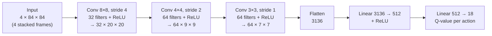
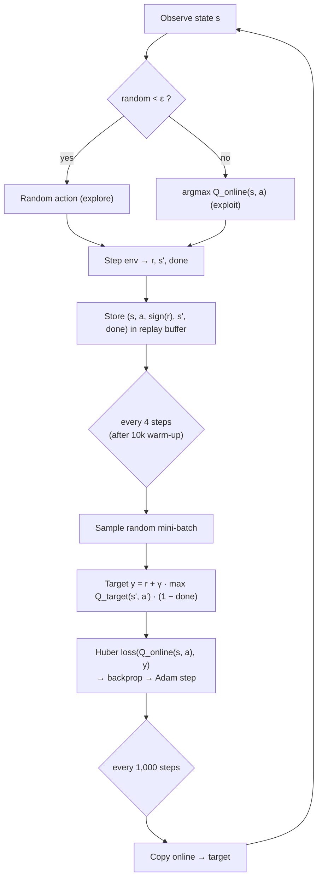
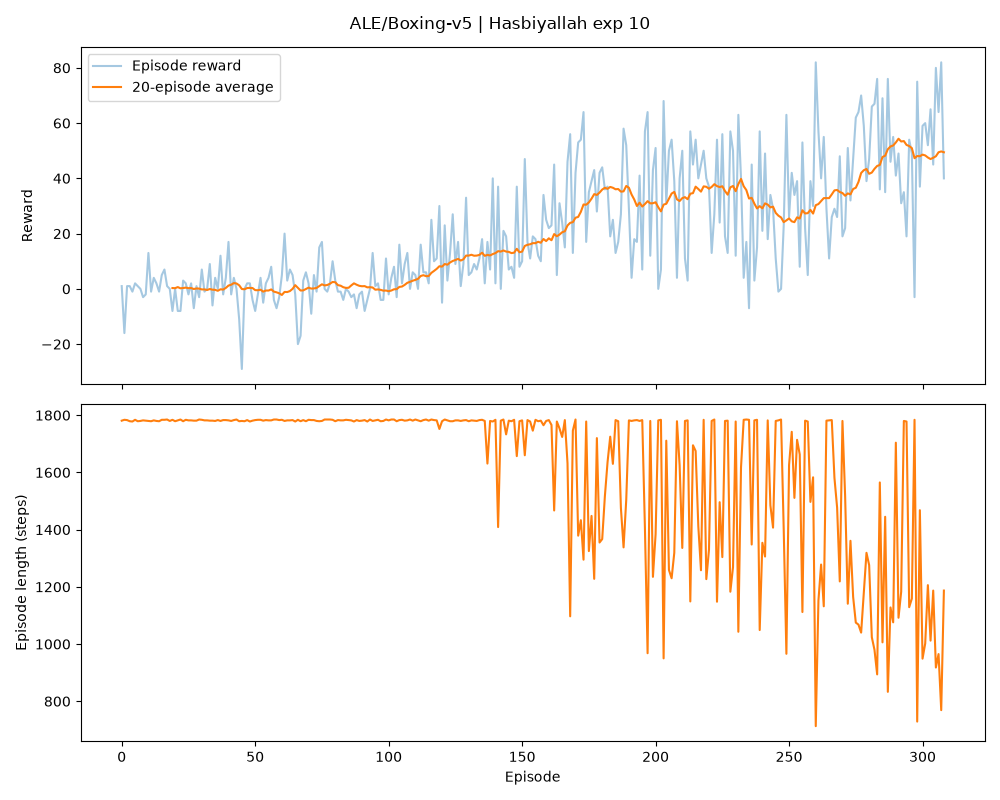
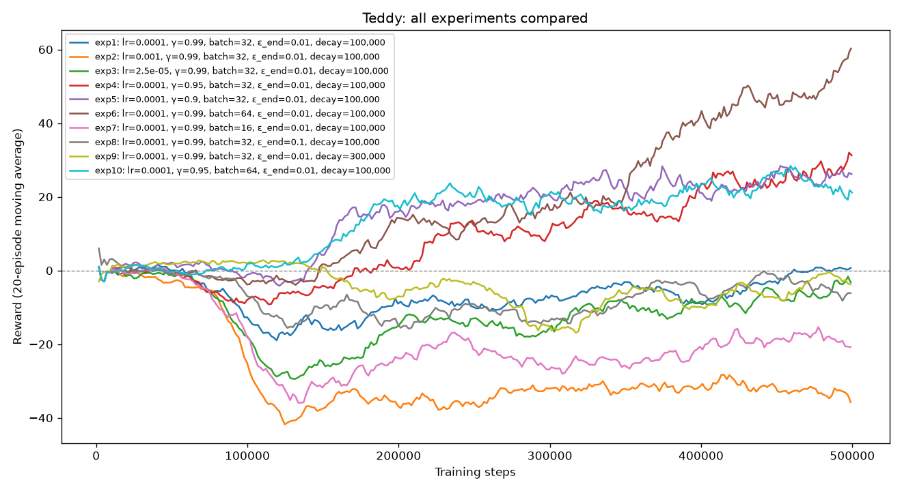
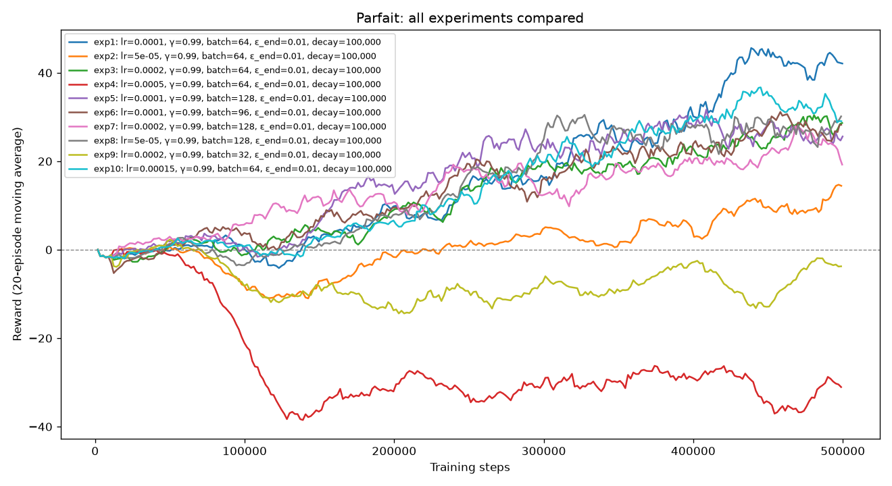
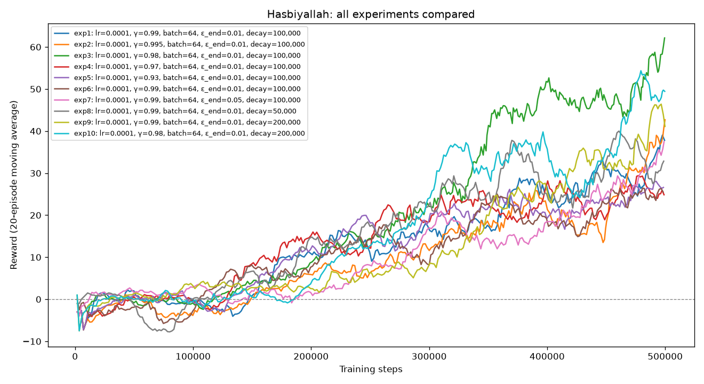

# Deep Q-Network (DQN) on Atari Boxing

A DQN agent built from scratch with **PyTorch** and **Gymnasium** that learns to play Atari Boxing from raw pixels. No ready-made DQN libraries were used (no Stable-Baselines3, RLlib, CleanRL or TorchRL): the network, replay buffer, ε-greedy policy, Bellman update and training loop are all our own code.

## 1. Project introduction

### Group members

| Member | Main contribution |
| --- | --- |
| Tedla Tesfaye Godebo | DQN implementation (`train.py`, `play.py`, `common.py`, `compare_experiments.py`), project setup with uv, 10 experiments (baseline sweep), final model selection, presentation booking, task allocation sheet, live demo |
| Parfait Uhiriwe | 10 experiments (learning rate and batch size), README, gameplay video, presentation introduction |
| Hasbiyallah Umutoniwabo | 10 experiments (gamma and exploration), presentation slides |

The full task breakdown is in `Task allocation sheet.pdf`.

### Environment: `ALE/Boxing-v5`

A top-down view of a boxing ring. Our agent controls the **white** boxer and fights the built-in computer opponent (**black**). The goal is to land more punches than the opponent.

- **+1** each time our agent lands a punch, **−1** each time it gets punched.
- A round lasts 2 minutes of game time (about 1,780 agent steps), or ends early by **knock-out** when one boxer lands 100 punches.
- The episode score is our punches minus the opponent's punches, so it ranges from **−100 to +100**. A random agent scores about 0; a positive score means our agent is winning.
- **Action space:** 18 discrete actions (NOOP, FIRE = punch, 8 movement directions, and each direction combined with a punch).

## 2. DQN architecture

Each observation is a stack of the **last 4 frames**, converted to grayscale and resized to 84×84. A single frame can't show which way the boxers are moving; four frames together show motion.



Two copies of this network are used:

- **Online network:** chooses actions and is updated by gradient descent.
- **Target network:** a frozen copy used to compute the learning targets. It is overwritten with the online weights every 1,000 steps, which stops the targets from shifting at every update and keeps learning stable.

### Training process



1. **Warm-up:** the first 10,000 steps fill the replay buffer before any learning happens.
2. **ε-greedy exploration:** ε decays linearly from `eps_start` to `eps_end` over `eps_decay` steps, then stays constant. Early on the agent mostly explores; later it mostly uses what it has learned.
3. **Reward clipping:** only the sign of the reward (+1 / 0 / −1) is stored for learning, as in the original DQN paper. In Boxing every reward is already ±1, so this has no effect here, but it keeps the code correct for other Atari games.
4. **Experience replay:** transitions are stored in a circular buffer (50,000 by default). Training on random mini-batches breaks the correlation between consecutive frames and reuses each experience many times.
5. **Bellman update:** the online network predicts Q(s, a); the target is `r + γ · max_a' Q_target(s', a')`, with the future term dropped when the round has truly ended (`terminated`, not a time-limit `truncated`). The Huber (smooth L1) loss between them is backpropagated, and Adam updates the online network.
6. **Target sync:** every 1,000 steps the target network copies the online weights.
7. **Logging:** each episode's length, total step count, reward and ε are written to `training_log.csv`, and a reward/length plot is saved at the end.

## Project structure

```
common.py                  environment setup + Q-network (shared by train.py and play.py)
train.py                   training loop: replay buffer, ε-greedy, Bellman update, target network
play.py                    loads dqn_model.pth and plays greedily in a game window
compare_experiments.py     draws all of one member's experiments on a single chart
dqn_model.pth              best trained model (copy of models/Hasbiyallah/exp10/dqn_model.pth)
models/<member>/exp<N>/    one folder per experiment: dqn_model.pth, training_log.csv,
                           training_plot.png, summary.json
<Member>_Hyperparameter_experiment_results.md   each member's experiment table
Task allocation sheet.pdf  who did what
replay_3d/                 interactive 3D replay of the final model's round (made with the help of Claude AI)
```

## Setup and usage (uv)

This project uses **uv** as its only package and environment manager.

```bash
uv sync    # create the environment and install all dependencies

# Train one experiment (this is the best configuration)
uv run train.py --member Hasbiyallah --exp 10 --seed 2 --lr 1e-4 --gamma 0.98 --batch_size 64 \
    --eps_start 1.0 --eps_end 0.01 --eps_decay 200000 --total_steps 500000

# Watch the best model play (press Q to close the window)
uv run play.py --model dqn_model.pth --episodes 3

# Compare all of one member's experiments on one chart
uv run compare_experiments.py --member Teddy
```

## Results

### Best configuration

Each member ran 10 experiments around a shared baseline, with each member exploring different hyperparameters:

- [Teddy_Hyperparameter_experiment_results.md](Teddy_Hyperparameter_experiment_results.md): learning rate, gamma, batch size and ε schedule (baseline sweep)
- [Parfait_Hyperparameter_experiment_results.md](Parfait_Hyperparameter_experiment_results.md): learning rate and batch size, and how they interact
- [Hasbiyallah_Hyperparameter_experiment_results.md](Hasbiyallah_Hyperparameter_experiment_results.md): gamma and exploration schedule

Our final model is **Hasbiyallah's experiment 10**:

| Hyperparameter | Value |
| --- | --- |
| Learning rate | 1e-4 |
| Gamma (γ) | 0.98 |
| Batch size | 64 |
| ε start → end | 1.0 → 0.01 |
| ε decay | 200,000 steps |
| Fixed settings | buffer 50,000 · target update every 1,000 steps · train every 4 steps · 10,000 warm-up steps · seed 2 |

### How we chose it

The training score (mean of the last 20 episodes) is a noisy measure: it includes 1% random moves and depends on where each run happened to be on its last swing. So we tested the four strongest models **greedily (no random moves, exactly as `play.py` plays) over the same 10 rounds**:

| Model | Training score (last 20) | Greedy test: mean of 10 rounds | Worst round | Knock-out wins |
| --- | --- | --- | --- | --- |
| **Hasbiyallah exp 10** (γ 0.98, ε decay 200k) | +49.45 | **+63.6** | +40 | **10/10** |
| Parfait exp 1 (baseline, seed 1) | +42.1 | +50.5 | +34 | 10/10 |
| Tedla exp 6 (baseline, seed 42) | +60.25 | +45.7 | +3 | 8/10 |
| Hasbiyallah exp 3 (γ 0.98) | +62.15 | +39.1 | −2 | 7/10 |

Hasbiyallah's exp 10 won every test round by knock-out and was never close to losing, so it is the model in `dqn_model.pth`. The two runs with the highest training scores (Tedla exp 6, Hasbiyallah exp 3) were the least consistent in the test, which shows why a separate evaluation matters.

### Training performance of the best experiment

| Metric | Value |
| --- | --- |
| Number of steps | 500,000 |
| Episodes played | 309 |
| Mean reward, last 20 episodes | **+49.45** |
| Best single episode reward | +82 |
| Mean episode length, last 20 episodes | **1,204 steps** (a full round is about 1,780) |
| Training time | 24.4 minutes (GPU) |

The shorter episodes are a sign of strength: a round only ends before about 1,780 steps when someone wins by knock-out.



The top panel shows the reward per episode with a 20-episode moving average; the bottom panel shows episode length. The score stays near 0 for the first 200,000 steps, because ε is still high and the agent plays mostly at random. Once ε reaches its minimum, the agent relies on its network and the score climbs steadily to about +50.

### Comparison of all experiments







**Limitation:** each configuration was trained once, and DQN results vary a lot between runs. The same baseline settings scored +60.25, +42.1 and +37.8 with three different seeds, and Hasbiyallah's re-runs with identical settings and seed also differed (GPU training is not fully deterministic). Large, repeated patterns are meaningful; gaps of 10–20 points may be chance.

## Gameplay demonstration

[](https://youtube.com/shorts/N3P--zuzV7Q)

This recording shows the final model (`dqn_model.pth`, Hasbiyallah's exp 10) playing one full round greedily, with the same display as `play.py` (score, step and the action the network chose). It wins by **knock-out, 100 punches to 30, a score of +70 after 857 steps**, less than half the length of a full round (about 1,780 steps).

## 3D replay (made with the help of Claude AI)

[`replay_3d/boxing_replay_3d.html`](replay_3d/boxing_replay_3d.html) is an interactive 3D replay of the same knock-out round as the video above. Download the file and open it in a web browser (an internet connection is needed to load the three.js library). You can play, pause and scrub through the round, slow it down to ¼ speed, switch cameras, rotate the ring and turn on punch sounds.

**This simulation was made with the help of Claude AI (Anthropic).** The 3D scene, the boxer models and the animation code were written with Claude's assistance; the data it replays comes from our own trained agent.

What is real and what is added:

- **Real, recorded from our final model:** where each boxer stands at every one of the 857 steps (read from the Atari console's memory), every punch that landed, the score and the action the network chose. [`replay_3d/extract_replay_data.py`](replay_3d/extract_replay_data.py) records this by playing the round greedily with `dqn_model.pth` (seed 1004) and saves it to `replay_3d/replay_data.json`:
  ```bash
  uv run python replay_3d/extract_replay_data.py
  ```
- **Added for the 3D view:** the human bodies, stance and footwork, punches that miss, impact effects and sound. The Atari game itself only stores positions and scores, so these are illustrations. The punches that land are timed to the exact step the game recorded them.
