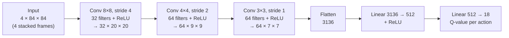
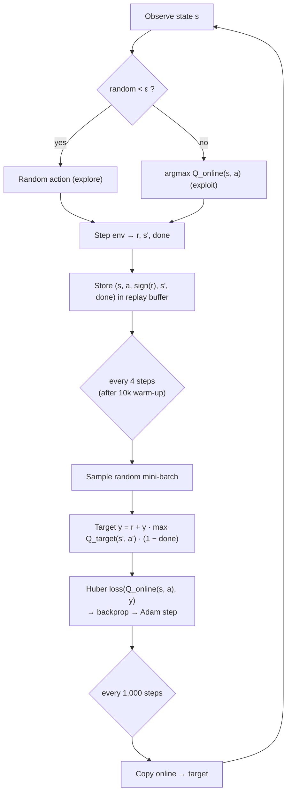

# Deep Q-Network (DQN) on Atari Boxing

A DQN agent implemented from scratch with **PyTorch** and **Gymnasium** (no Stable-Baselines3, RLlib, CleanRL or TorchRL) that learns to play Atari Boxing from raw pixels.

## Group members

| Member | Role / main contribution |
|---|---|
| Tedla Tesfaye Godebo | DQN implementation (`train.py`, `play.py`, `common.py`), hyperparameter experiments, live demo |
| Parfait | Hyperparameter experiments (learning rate, batch size), README, demo video |
| Hasbiyallah | Hyperparameter experiments (gamma, exploration), slides, presentation booking, task allocation sheet |

See `Task allocation sheet.pdf` for the full task breakdown.

## Environment: `ALE/Boxing-v5`

A top-down view of a boxing ring. The agent controls the white boxer and fights the built-in computer opponent (black). **Goal: land more punches than the opponent.**

- **+1** each time the agent lands a punch, **−1** each time it gets punched.
- A round lasts 2 minutes of game time, or ends early with a knock-out when one boxer lands 100 punches.
- The episode reward is the agent's punches minus the opponent's punches, so it ranges from **−100 to +100**. A random agent scores about 0; a positive score means the agent is winning.

Action space: 18 discrete actions (NOOP, FIRE = punch, 8 movement directions, and each direction combined with a punch).

## Project structure

```
common.py        environment setup + Q-network (shared by train.py and play.py)
train.py         training loop: replay buffer, epsilon-greedy, Bellman update, target network
play.py          loads dqn_model.pth and plays greedily in a game window
dqn_model.pth    best trained model (copied from the best experiment)
models/<member>/exp<N>/   one folder per experiment: dqn_model.pth, training_log.csv,
                          training_plot.png, summary.json
<Member>_Hyperparameter_experiment_results.md   each member's experiment table
```

## Setup and usage (uv)

```bash
uv sync                                   # create the environment and install dependencies

# Train one experiment
uv run train.py --member Teddy --exp 1 --lr 1e-4 --gamma 0.99 --batch_size 32 \
    --eps_start 1.0 --eps_end 0.01 --eps_decay 100000 --total_steps 1000000

# Watch the best model play
uv run play.py --model dqn_model.pth --episodes 3
```

## DQN architecture

Each observation is a stack of the **last 4 frames**, converted to grayscale and resized to 84×84, so the network can see motion (which way the ball is moving).



Two copies of this network are used:

- **Online network** – chooses actions and is updated by gradient descent.
- **Target network** – a frozen copy used to compute the learning targets; it is overwritten with the online weights every 1,000 steps. This keeps the targets from shifting at every update, which stabilises learning.

## Training process



1. **Warm-up** – the first 10,000 steps fill the replay buffer before any learning.
2. **ε-greedy exploration** – ε decays linearly from `eps_start` to `eps_end` over `eps_decay` steps, then stays constant. Early on the agent mostly explores; later it mostly exploits what it has learned.
3. **Reward clipping** – only the sign of the reward (+1 / 0 / −1) is stored for learning, as in the DQN paper, so large rewards in other games can't cause unstable updates. In Boxing every reward is already +1 or −1, so this has no effect here.
4. **Experience replay** – transitions are stored in a circular buffer (50,000 by default). Training on random mini-batches breaks the correlation between consecutive frames.
5. **Bellman update** – the online network predicts Q(s, a); the target is `r + γ · max_a' Q_target(s', a')`, with the future term dropped when the game is over. The Huber (smooth L1) loss between them is backpropagated and Adam updates the online network.
6. **Target sync** – every 1,000 steps the target network copies the online weights.
7. **Logging** – each episode's length, total step count, reward and ε are written to `training_log.csv`, and a reward/length plot is saved at the end.

## Results

_Best configuration, final average reward and training plot of the best experiment go here._


## Gameplay demonstration

_Add the video of the best agent here._
