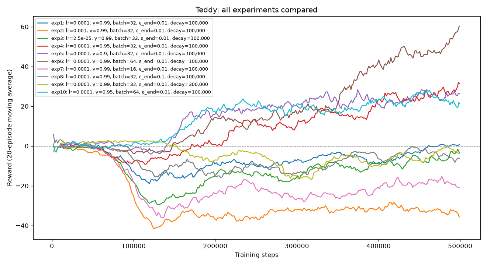

# Hyperparameter Experiments – Tedla Tesfaye Godebo (Teddy)

Environment: `ALE/Boxing-v5` · Steps per experiment: 500,000 · Fixed settings: buffer 50,000, target update every 1,000 steps, train every 4 steps, 10,000 warm-up steps.

Experiment 1 is the baseline; experiments 2–9 change **one** hyperparameter at a time so its effect can be isolated; experiment 10 combines the best values found.

Score = agent's punches − opponent's punches (−100 to +100; 0 = even fight). A round lasts 1,780 steps unless a boxer wins by knock-out (100 punches), so **shorter episodes in a good run mean the agent is winning by knock-out**.

| Exp | Learning rate | Gamma | Batch size | Epsilon start | Epsilon end | Epsilon decay (steps) | Mean game score (last 20 ep.) | Observed behaviour |
|---|---|---|---|---|---|---|---|---|
| 1 | 1e-4 | 0.99 | 32 | 1.0 | 0.01 | 100,000 | +0.7 | Baseline. Dipped to about −19 once ε reached its minimum, then recovered slowly to an even fight. Still improving at the end. |
| 2 | 1e-3 | 0.99 | 32 | 1.0 | 0.01 | 100,000 | −35.7 | **Worst.** Learning rate too high: score collapsed to −42 and never recovered. Large weight updates overshoot, so the Q-values never settle. |
| 3 | 2.5e-5 | 0.99 | 32 | 1.0 | 0.01 | 100,000 | −3.2 | Learning rate too low: deep dip (−29), then very slow recovery. The direction was right but the steps too small to get far in 500k steps. |
| 4 | 1e-4 | 0.95 | 32 | 1.0 | 0.01 | 100,000 | +31.3 | Much better than γ = 0.99. Almost no dip, steady climb, started winning by knock-out (72 KO rounds). Still rising at the end. |
| 5 | 1e-4 | 0.90 | 32 | 1.0 | 0.01 | 100,000 | +26.2 | Learned fastest early (+15 by 160k steps) but levelled off around +25. Short-sighted agent: good at landing the next punch, less good at setting up later ones. |
| 6 | 1e-4 | 0.99 | 64 | 1.0 | 0.01 | 100,000 | +60.3 | **Best.** Bigger batch = smoother, more reliable updates. Climbed fastest in the second half and won most late rounds by knock-out (average round 1,108 steps). Still rising. |
| 7 | 1e-4 | 0.99 | 16 | 1.0 | 0.01 | 100,000 | −20.8 | Small batch = noisy gradient estimates. Dipped to −36 and stayed well below zero. |
| 8 | 1e-4 | 0.99 | 32 | 1.0 | 0.10 | 100,000 | −6.2 | 10% random moves even after training, so the agent keeps making mistakes the opponent punishes. Slightly worse than the baseline. |
| 9 | 1e-4 | 0.99 | 32 | 1.0 | 0.01 | 300,000 | −3.8 | Explored longer: stayed near 0 (random play) for longer, but then dipped later and had less time left to improve. Slightly worse than the baseline. |
| 10 | 1e-4 | 0.95 | 64 | 1.0 | 0.01 | 100,000 | +21.2 | Combination of best values (batch 64 from exp 6, γ = 0.95 from exp 4). Learned fast and never dipped (lowest 20-ep. average −1.2), but levelled off around +20 to +28 after 200k steps. **Worse than both exp 4 and exp 6:** the best values did not add up. |



## Commands

```bash
uv run train.py --member Teddy --exp 1  --lr 1e-4   --gamma 0.99 --batch_size 32 --eps_end 0.01 --eps_decay 100000 --total_steps 500000
uv run train.py --member Teddy --exp 2  --lr 1e-3   --gamma 0.99 --batch_size 32 --eps_end 0.01 --eps_decay 100000 --total_steps 500000
uv run train.py --member Teddy --exp 3  --lr 2.5e-5 --gamma 0.99 --batch_size 32 --eps_end 0.01 --eps_decay 100000 --total_steps 500000
uv run train.py --member Teddy --exp 4  --lr 1e-4   --gamma 0.95 --batch_size 32 --eps_end 0.01 --eps_decay 100000 --total_steps 500000
uv run train.py --member Teddy --exp 5  --lr 1e-4   --gamma 0.90 --batch_size 32 --eps_end 0.01 --eps_decay 100000 --total_steps 500000
uv run train.py --member Teddy --exp 6  --lr 1e-4   --gamma 0.99 --batch_size 64 --eps_end 0.01 --eps_decay 100000 --total_steps 500000
uv run train.py --member Teddy --exp 7  --lr 1e-4   --gamma 0.99 --batch_size 16 --eps_end 0.01 --eps_decay 100000 --total_steps 500000
uv run train.py --member Teddy --exp 8  --lr 1e-4   --gamma 0.99 --batch_size 32 --eps_end 0.10 --eps_decay 100000 --total_steps 500000
uv run train.py --member Teddy --exp 9  --lr 1e-4   --gamma 0.99 --batch_size 32 --eps_end 0.01 --eps_decay 300000 --total_steps 500000
uv run train.py --member Teddy --exp 10 --lr 1e-4   --gamma 0.95 --batch_size 64 --eps_end 0.01 --eps_decay 100000 --total_steps 500000
```

Comparison chart: `uv run compare_experiments.py --member Teddy`

## Best and worst configurations

- **Best:** exp 6 (batch size 64), +60.3. Each update averages over twice as many past experiences, so the gradient is less noisy and every update teaches the network more.
- **Worst:** exp 2 (learning rate 1e-3), −35.7. The updates were too large: each one overshoots, and because the Bellman targets come from the network itself, the errors feed back into the targets and learning never stabilises.

## What helped and what hurt

- **Learning rate:** 1e-4 was the best of the three. 10× higher (1e-3) made training collapse; 4× lower (2.5e-5) was stable but too slow.
- **Gamma:** lowering it from 0.99 to 0.95 or 0.90 helped a lot (+0.7 → +31 / +26). In Boxing a punch is rewarded almost immediately, so the agent doesn't need to look far ahead; a smaller γ gives shorter-range, less noisy targets that are easier to learn. 0.90 learned fastest early but levelled off, while 0.95 kept improving.
- **Batch size:** the biggest effect. 64 was by far the best (+60), 16 was clearly bad (−21). Larger batches give smoother gradient estimates.
- **Epsilon schedule:** neither change beat the baseline. A higher final ε (0.10) leaves too many random moves in the final policy; a longer decay (300k steps) delays learning and leaves less time to improve within 500k steps.
- **Common pattern:** most γ = 0.99 runs dipped below zero right after ε reached its minimum (around 100k steps). At that point the agent switches from mostly random play to its own still-weak Q-values, and the opponent exploits its repeated mistakes until the network improves.

**Limitation:** each configuration was run once (one random seed), and DQN results vary between runs. Large gaps (+60 vs +0.7, or −36) are reliable; small gaps (e.g. −3.2 vs −3.8) could be chance.

## Final configuration and justification

**Chosen: experiment 6:** learning rate 1e-4, γ = 0.99, batch size 64, ε 1.0 → 0.01 over 100,000 steps.

- It had the highest training score (+60.3), and it was still improving when training stopped.
- Tested greedily (no random moves, exactly as `play.py` plays) over 5 rounds, it scored **+44, +74, +75, +43, +57 (mean +58.6)** and won **every round by knock-out**. For comparison, exp 4 averaged +45.8 and exp 10 +27.4 in the same test.
- Experiment 10 (the "best values combined") did worse, which shows hyperparameters interact and their effects don't simply add up. The gamma results suggest why: a lower γ (0.90, 0.95 in exps 5, 4 and 10) learns faster at first but levels off, because the agent only values punches in the near future. With γ = 0.99 the agent learns more slowly, but it can value moves that set up punches several seconds later. Combined with a large batch for stable updates (exp 6), that gave the highest final score.

The trained model is saved as `dqn_model.pth` (a copy of `models/Teddy/exp6/dqn_model.pth`).
